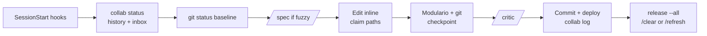

# The workflow, in full

This is how one developer builds with Claude Code: one inline session per task, every important rule enforced by a hook, and a second model reviewing every real diff. The setup grew between April and September 2026 while several Claude sessions at a time worked on two production web apps. One was a goal-planning and calendar app on Supabase and Vercel. The other was an adaptive practice app with a FastAPI backend on Fly. Most rules below came out of an incident, and the incidents are dated in [History](#history).

## Principles

- **Work inline, where you can watch it.** No subagents and no Workflow fan-outs; a hook blocks them. If a job looks too big to do inline, stop, propose a smaller scope, and let the human decide.
- **Prefer hard guards to soft prose.** A rule that failed twice as CLAUDE.md text becomes a PreToolUse hook. This follows Karpathy's three layers: spec (Layer 1), critic (Layer 2), environment guards (Layer 3).
- **Use Git as a running instrument.** Check status before, during and after every change, and report it as a checkpoint line with a severity level.
- **Run several live sessions per repo.** `collab` claims, requests and logs are the only channel between them. Dirty work belongs to the human or to another session, never to you.
- **Verify across models.** `/critic` sends each meaningful diff to Codex before commit, before deploy, and before telling the human it works.
- **Validate, don't assert.** Check the real browser, the real DB payloads and the real deploy read-back. Passing tests don't mean a clean worktree or a working feature.
- **Finished means shipped.** Commit, push and deploy each finished feature without asking.
- **Keep prose compressed.** Caveman mode is on by default. Code, commits and security text stay normal prose.
- **Watch structural health.** Modulario scores every file after each edit, and a blocking error stops all work.
- **Use CLIs, never dashboards.** Vercel, Supabase, Fly, GitHub and Google are all driven from their CLIs, so Claude can do the work itself and read back the result. A dashboard is only for creating the token the CLI needs.
- **Always run Claude with `--dangerously-skip-permissions`.** There are no approval prompts. The hooks are the safety net instead.

## Session lifecycle

A session covers one task. It starts with the hooks and a collab check-in. The work happens inline with Git checkpoints, gets verified with `/critic`, and ships. Then the session releases its claims and ends with `/clear` or `/refresh`.

**Automatic at start:** `caveman-ultra.sh` turns on compressed replies. `graphify-startup.sh` surfaces the knowledge graph when `graphify-out/` exists. Project hooks can inject alerts, such as DB egress spikes or this week's goals.

**Manual start ritual in a repo:**

1. `CLAUDE_SESSION_ID=<id> collab status`, `collab history -n 10`, `collab inbox`.
2. `git status --short --branch` plus an untracked count, reported as a checkpoint.
3. Start any long-running watchers the project uses (Monitor tasks that wake the session on user feedback or alerts).
4. Read the memory files that `MEMORY.md` points to for this area.

**Ending:** run `collab release --all` once the work lands, and recheck Git right before the final reply. Use `/clear` between tasks. Use `/refresh` instead of `/compact`: it writes a hand-off prompt for a fresh session. Never switch `/model` or `/fast` mid-session, because each switch rebuilds the prompt cache. Stop hooks log token stats, send a desktop notification, and run Modulario's stop gate.

## Git discipline

Check Git throughout a task, not just at the end, and put a one-line checkpoint in every update.

**When to run** `git status --short --branch`: before the first edit, after each logical batch of changes, after every Git-mutating operation, before switching areas, and right before the final reply. Count untracked files with `git ls-files --others --exclude-standard`, because collapsed directories undercount.

**Checkpoint format** (one line per repo):

`Git: HEAVY — repo=my-app branch=main; staged=0, unstaged=158, untracked=115, conflicts=0. Mixed scopes; preserving unrelated changes.`

If the directory isn't a repo, write `Git: unavailable (not a repo)`, never "clean".

| Level | Meaning |
| --- | --- |
| CLEAN | Nothing changed |
| LIGHT | 1–10 paths, one scope |
| MODERATE | 11–50 paths, or several scopes |
| HEAVY | More than 50 paths, or broad/mixed work |
| CRITICAL | Conflicts, unexpected deletions, risky staged/unstaged overlap, suspected secrets, generated user data |

**Rules:**

- Preserve unrelated changes: they belong to someone else.
- At MODERATE or above, stage explicit paths or use `git add -p`. Never use `git add .` or `-A` in a shared repo.
- Never commit, stash, restore, reset or clean just to make the status look clean. Destructive operations need explicit approval and a recoverable safety point.
- Never `git stash`. The stash is worktree-global, and it swept away another session's work twice. Use a temporary `git worktree` instead.
- The index is shared too. Another session's commit twice swallowed freshly staged files. Stage and commit in one command.
- If you commit files you didn't write, `collab log` the sha so the author can find their work.

## Multi-session coordination (`collab`)

Several Claude sessions often work in one repo at once, and `collab` is how they learn about each other. It was built after two sessions edited the same files without knowing it. Source and details: [`collab/README.md`](../collab/README.md).

- **State** lives in `~/.local/state/agent-collab/<repo>-<hash>/` and is keyed on the common git dir, so every worktree shares one view.
- **Session id:** always prefix commands with `CLAUDE_SESSION_ID=<this session's id>`. Without it, each Bash call becomes a new ghost `shell-<ppid>` session, and your own claims start blocking your own edits.
- **Claims** happen automatically on a successful edit (PostToolUse), or explicitly with `collab claim <paths> --why "<task>"`. They are keyed by repo-relative path so worktrees collide correctly. A claim goes stale after 90 minutes without a heartbeat. The guard fails open.
- **Denials:** a PreToolUse hook denies an edit to a file another live session owns. That is a message, not a bug. Run `collab request <path> "<what you need>"` and let the owner make the change.
- **Deploy etiquette:** check `status` and `history` first. Don't deploy if another session says its work is unfinished. Log `deploying <channel> from <sha>` before the deploy and the result after.
- **Deploy holds:** any half-finished state that would break a deploy, such as markup linking an unwritten file or an unapplied migration, gets logged as a hold right away and released when it's fixed.
- **Isolation:** `agent-worktree new <name>` creates branch `agent/<name>` in a sibling directory, never inside the repo.

## Verification

Three layers stop bad code: `/spec` before writing, `/critic` after, and checks in the real environment before claiming anything works.

### `/critic`: cross-model review (Layer 2)

Codex reviews Claude's diff read-only. The model and effort are pinned in Modulario's `run_critic.py` and in `~/.codex/config.toml`. The effort once dropped silently from `xhigh` to `medium`, so check it. Running `/critic` is the default, not the exception.

- **Run it without asking** after any non-trivial diff, when a requested bug fix seems done, and before every commit or deploy. Always run it for high-stakes areas: scoring math, the deploy pipeline, DB writes and migrations, auth, money, and real user data. Also run it on any review request and whenever you're uncertain.
- **Skip it only** for doc, comment or typo-only edits, one-line config flips, read-only work, or when already acting as critic (`MODULARIO_CRITIC_ACTIVE=1`). If you skip it on a real diff, say so in the reply and give the reason.
- **Invoke it as author `claude`:** `env -u MODULARIO_CRITIC_ACTIVE python3 ~/Applications/Modulario/scripts/run_critic.py claude [base|--files paths...]`.
- `--files` diffs the working tree. For committed work, apply your diff in a detached worktree and review it there, which also keeps other sessions' files out.
- **Reconcile, don't relay.** Report which findings you agree on, which only Codex raised (and whether you verified them), which only Claude raised, and which are disputed. Fix verified small refactors now and document big ones. The critic never edits. Reading a diff is not running the code, so still verify.

### `/spec`: spec first (Layer 1)

Use it for any build whose goal, scope or success criteria are unstated. Interview for the decision the build drives, carve the smallest reviewable slice, write checkable success criteria, and get explicit sign-off before writing code. `/interview-me` and `/prompt-master` are lighter variants for briefs and prompts.

### Validate, don't assert

- Exercise UI changes in a real browser via `chrome_dev` and Playwright over CDP. Check data claims against live DB rows or payloads.
- Each folder's `watch.py` pins invariants, and Modulario runs them.
- Deploys verify themselves: write a `/channel.json` with channel, commit and time, read it back off the live URL, and fail on a mismatch.
- Report outcomes faithfully: report failing tests with their output, and name skipped steps.

## Tooling triad: Modulario, graphify, caveman

Three layers work over the same codebases: Modulario watches file structure, graphify maps meaning, and caveman compresses prose.

### Modulario: structural health (authoritative)

- A `[Modulario]` block appears after every write or edit. `pre_edit_gate.py` runs before edits and `stop_gate.py` runs at Stop.
- **A blocking error stops everything.** Fix the violation before any further edit.
- STATUS GREEN / LIME / YELLOW / ORANGE / RED is the file's combined LOC and DEPS score. For an ORANGE or RED file, add no lines or imports and consider a split. Note it when one edit climbs a tier.
- `[DOC]` and `[WATCH]` nags mean a folder's `README.md` or `watch.py` is still a template. Fill it in place with Read then Edit, never Write: the line-1 marker is a state flag, and a Write races Modulario's regeneration.
- Update a folder's README when its behavior, API, key files or invariants change, and add a dated Recent Changes entry.
- Run `mod graph <file>` before moving, splitting or renaming a file; it shows every caller. `mod query` gives the health report and `mod agents` shows the agent budget.
- The `/modulario-ops` skill has the full command reference.

### graphify: semantic map

`/graphify` builds a persistent knowledge graph of a codebase, with god nodes, communities, and `query` / `path` / `explain`. When `graphify-out/` exists, send architecture questions to the graph before grepping. The skill's own "use agents" step is done inline.

### caveman: compression

Caveman is on by default at ULTRA through a SessionStart hook: fragments, no filler, arrows for causality. Code, commits and security writing stay normal prose. `/caveman:compress <file>` compresses a prose file in place, but never point it at a Modulario template or a vendor file.

## Skills

| Skill | Used for |
| --- | --- |
| `/critic` | Codex review of a Claude diff; the default after any real change |
| `/spec` | Interview → smallest slice → sign-off before coding a fuzzy build |
| `/interview-me` | One-question-at-a-time brief for big or fuzzy tasks |
| `/prompt-master` | Write, rewrite or audit prompts, CLAUDE.md files and skills for Claude 5 |
| `/refresh` | Hand-off prompt for a clean new session (lite / full / ultra), used instead of `/compact` |
| `/modulario-ops` | Modulario command reference, filling README / watch.py templates, refactors |
| `/mockup` | Static UI mockup variants with a scene per state, served for click-through before coding |
| `/graphify` | Build and query a codebase knowledge graph (plugin) |
| `caveman:*` | `caveman`, `caveman-commit`, `caveman-review`, `compress` (plugin) |
| `frontend-design` | Production-grade UI builds (plugin) |

A skill that tells Claude to spawn agents does not override the no-subagents rule. Do that step inline.

## Hooks and guards

| Event | Hook | What it does |
| --- | --- | --- |
| PreToolUse | `hooks/pretooluse_guard.py` | Blocks Agent/Task/Workflow spawns past the budget (`mod agents`) and Vercel Workflow code in JS/TS files |
| PreToolUse | Modulario `pre_edit_gate.py` | Refuses edits while a blocking Modulario error stands |
| PreToolUse | agent-collab (per repo, `.claude/settings.local.json`) | Denies edits to files another live session claims |
| PostToolUse | Modulario `modulario-hook.sh` | Scores the file, prints `[Modulario]`, runs `watch.py` checks |
| PostToolUse | `loc_tracker_hook.py` | Tracks lines read and written |
| SessionStart | `caveman-ultra.sh`, `graphify-startup.sh` | Compression mode; graph hint |
| UserPromptSubmit | `cache_guard.py` | Blocks a prompt that would rebuild a cold cache of 60k+ tokens and copies it to the clipboard |
| Stop | `token_stats_hook.py`, `stop_notify.sh`, Modulario `stop_gate.py` | Token log, desktop notification, stop checks |
| SubagentStop | `token_stats_hook.py` | Token log |

Treat a blocked call as a message from the system, not something to route around. Run legitimate overrides by hand as `! <cmd>`.

Guard design rules, learned the hard way:

- Fail **closed** on data: an unreachable DB or a missing config means locked. Fail **open** on harness parse errors, because a format change is not evidence.
- Any hook that spawns `xclip` or a daemon must give it DEVNULL stdout, or Claude Code waits until the hook times out.
- A hook installed mid-session takes effect in the next session. Verify it with a self-test, not live.
- A `settings.local.json` Bash `deny` list plus hooks cover what either misses alone.
- Editing a guard, or `stopgate.json`, to get past it defeats the control; it is not a workaround.

## Deploys

Each finished feature ships without asking, through the project's own deploy script, never a hand-run `vercel deploy`. Announce every deploy in `collab` before and after. The patterns that held up:

- **Two channels.** `deploy beta` publishes the working tree, uncommitted work included, on purpose. `deploy stable` deploys a `git archive` of a `stable-*` tag, so uncommitted work can't reach users. `stable <older-tag>` rolls back, and `stable --promote` tags HEAD, deploys, then pushes the tag. This split was built the day after an unfinished render reached production and blanked a real user's data.
- **Read back.** Each deploy writes `/channel.json` and reads it off the live URL. A stale-build guard reloads idle tabs when the commit changes.
- **Point the default link at beta.** An old-habit `vercel deploy --prod` from the wrong directory then lands somewhere safe.
- **Two DB projects (stable and beta).** Verify the project ref before any query or migration. Migration files are not the DB, so diff the applied migrations before promoting.
- **Trap: deploy scripts resolve the repo from their own path, not your cwd.** A worktree does not isolate you. Deploy from a temporary `git clone` at your commit when others have in-flight edits.
- **Trap: installed copies of ops scripts drift** from the repo. `cmp` them before trusting them.
- **Trap: a `.vercelignore` can silently drop runtime-fetched files.** An SPA rewrite returns 200 `text/html` for them, so check the `content_type`.
- **New services go to Fly.** Prune old Vercel deployments with `vercel rm <proj> --safe` before hitting the storage cap. Keep backup scripts per project and take nightly DB dumps off-box.

## Browser debugging and live data

Reason from real DOM and network payloads, never from guesses.

- **`chrome_dev <url>`** launches a debug Chrome on port 9222. It accepts full URLs, `host:port`, a bare port, or a path on `CHROME_DEV_ORIGIN`. It runs headless by default; pass `--headed` or set `CHROME_DEV_HEADLESS=0` to see it. `--stop` kills it.
- **CDP Playwright harness:** in a scratch directory, `python3 -m venv pw && pw/bin/pip install playwright`, then `chromium.connect_over_cdp("http://127.0.0.1:9222")`. No browser download is needed.
- **Never drive the user's own browser.** The :9222 Chrome is shared between sessions, so close stray tabs.
- **Gotchas:** `page.evaluate` sees script-global consts, but `window.X` is undefined for them. `locator.check()` fails on visually hidden radios, so click the label. A `display:none` element measures top 0, and a hidden tab clamps `scrollY`.
- **Reproduce first.** When a bug is reported, get repro steps, logs or screenshots, and reproduce it before touching code.

## Memory

Persistent memory is a folder of one-fact files indexed by `MEMORY.md`, which loads into every session. The notes behind the rules above are in [`memory/`](../memory/README.md).

- **File shape:** frontmatter (`name` slug, a one-line `description`, and `type`: user, feedback, project or reference), then the fact. Feedback and project notes add **Why:** and **How to apply:** lines. Related notes link with `[[slug]]`.
- **Index:** one line per memory, grouped by project, with status markers (fixed/live, in progress, trap, retired).
- **Size:** the index gets truncated past about 24 KB. Keep lines under about 200 characters, move detail into topic files, and move old pointers to an archive file.
- **Upkeep:** update an existing file rather than duplicating it, and delete wrong memories. Don't save what the repo or git history already records. Convert relative dates to absolute ones.
- **Treat memories as dated.** Before recommending a file, flag or function a memory names, verify it still exists.

## Cost and tokens

Cost is driven by session length times context size. These rules keep sessions short, inline and cache-warm.

| Rule | Why |
| --- | --- |
| No subagents, no Workflow tool, no fan-outs | One Workflow run used the whole session limit in under 20 minutes. A token-saving task spawned 30 agents (~1.5M tokens) and damaged 10 READMEs |
| No Vercel Workflow / Workflow DevKit / `@workflow/*` | Cost. Use plain API routes, cron, queues, scripts or DB state machines instead |
| `/clear` per task, `/refresh` to hand off | An audit found one 22-hour, 859-turn session billed 140M tokens at a 151k median context |
| Never `/model` or `/fast` mid-session | Each switch rebuilds the prompt cache; that session had seven rebuilds |
| Cache guard on prompt submit | A 70-minute break cost a 237k-token rebuild. The hook now blocks a cold 60k+ prompt and saves it to the clipboard |
| Trim the session floor | The floor was 60–73k tokens before the first prompt. Remove unused MCP servers and plugins, and archive old memory lines |
| `/critic` stays mandatory | One Codex call per real diff is cheaper than shipping a bug |

Settings: prompt cache TTL 1 h, `autoCompactWindow` 150000. The statusline shows cache warmth, hit rate and expiry. `cache_watch.py` nudges before expiry. Token stats are logged on every Stop.

## Hard-won lessons

The same few failure shapes keep coming back. Check for them before calling anything done.

**Data loss**

- A save that never read the data erases it. Whole-document writes replace, so always merge.
- Every write must announce itself. A stale surface that missed a change will save over it.
- Every layer is an allowlist. A field that one channel or serializer doesn't map gets silently dropped.
- Loss isn't always smaller. A shrink guard should compare work done, not length, and saves should be compare-and-set.
- A handoff between windows must flush in both directions, or a stale whole-document erases the other window's work.

**Silent wrong answers**

- A filter on the wrong id type matches 0 rows with no error.
- `null` is not 0, and `seen=0` is a real answer.
- Existing is not the same as visible: watch for `display:none`, and for `[hidden]` losing to `display:grid`.
- Probe exit codes lie. `/health` returns 200 with the DB gone, and SPA rewrites return 200 HTML for missing files.

**Shared worktrees**

- The stash, the index and `git add -A` are all shared with other sessions.
- Deploy scripts resolve paths from themselves, not from your cwd.
- A deployed worktree is output; author only in the main checkout.

**Process**

- Rules written as prose failed twice before becoming hooks. If a rule matters, enforce it at the tool level.
- Measure before claiming a saving.
- Observe the real thing before measuring or fixing it, and read the source of whatever you're copying.
- Fix causes, not symptoms: kill the duplicate-id generator instead of deduping downstream.

## History

| Date | Event |
| --- | --- |
| 2026-09-21 | Never drive the user's browser; browser checks only via headless `chrome_dev` |
| 2026-09-16 | Token audit (140M-token session found); cache guard hook; Playwright and relay MCPs removed; memory archive split out |
| 2026-09-07 | Codex critic effort found silently at `medium`; pinned back to `xhigh` |
| 2026-09-06 | Playwright MCP dead → scratchpad CDP harness; Vercel storage cap hit |
| 2026-09-05 | Stale-build guard on both channels; `chrome_dev` headless by default |
| 2026-08-18 | agent-collab built and enforced (claims, deny hook, `agent-worktree`); never-stash rule hardened; DB shrink guard soft-rejects lossy writes |
| 2026-08-14 | Deploy worktree trap: another session's 19 uncommitted files reached beta for ~90 s |
| 2026-08-12 | Standing order: commit, push and deploy every finished feature |
| 2026-08-07 | Split into two Supabase projects (stable, beta) |
| 2026-08-06 | Weekly-data wipe from a save that never read the period; restored by merging from backup |
| 2026-07-28 | Agent block becomes a budget (`mod agents`, default 0); nightly backups |
| 2026-07-27 | Release channels (beta/stable) built, a day after a prod deploy blanked a user's yearly goals |
| 2026-07-23 | 30-agent fan-out incident (~1.5M tokens, 10 READMEs damaged) → no-subagents hook |
| 2026-07-12 | De-Vercel direction: new services go to Fly; Supabase project restricted for egress overage |
| 2026-07-10 | `/critic` and `/spec` skills; PreToolUse hard guards (Karpathy Layers 1–3) |
| 2026-07-07 | Workflow tool banned after one run used the whole session limit in 20 minutes |
| 2026-06-02 | `chrome_dev` created; CDP becomes the main debug path |
| 2026-04-12 | Modulario built; "fill templates in place" rule |
